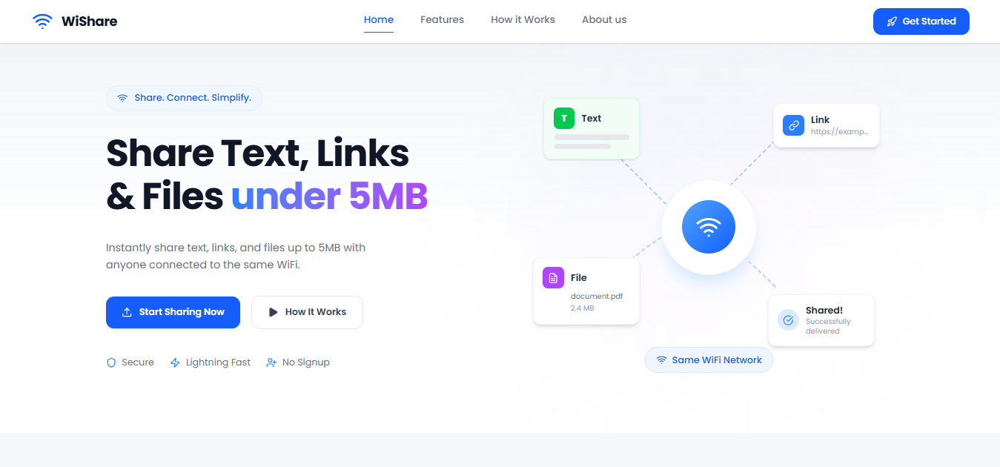
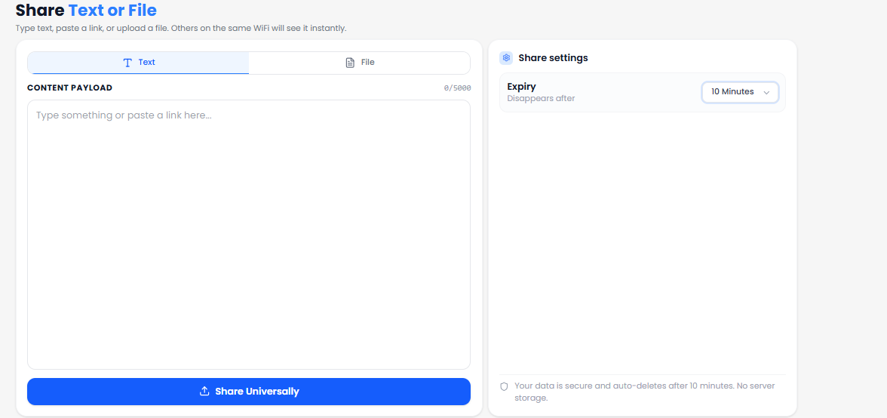
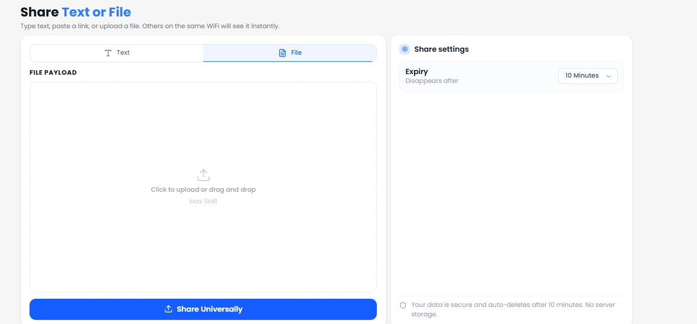
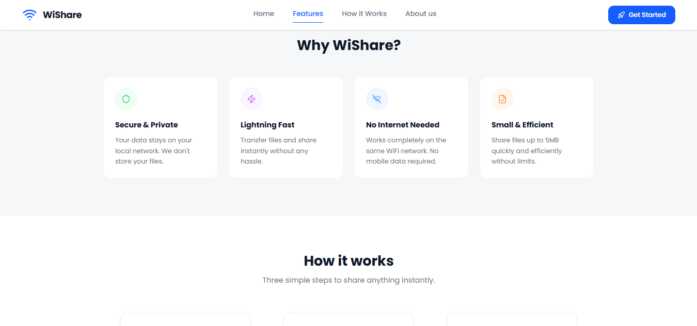
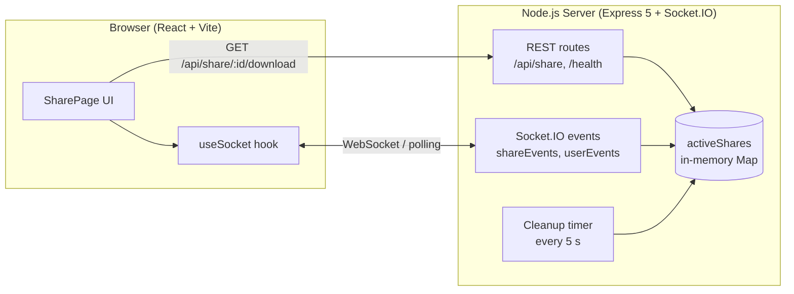
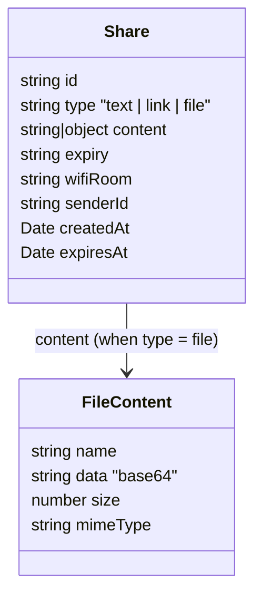

<div align="center">

# WiShare

**Instant text, link, and file sharing between devices on the same Wi-Fi network — no account required.**


</div>

> **Naming note:** the repository folder is `AirForShare Clone`, while the application UI and copy brand itself as **WiShare**. This README uses *WiShare*.

---

## Table of Contents

1. [Project Overview](#project-overview)
2. [Key Features](#key-features)
3. [Screenshots / Demo](#screenshots--demo)
4. [Technology Stack](#technology-stack)
5. [Project Architecture](#project-architecture)
6. [Folder Structure](#folder-structure)
7. [Prerequisites](#prerequisites)
8. [Installation and Setup](#installation-and-setup)
9. [Environment Variables](#environment-variables)
10. [Running the Project](#running-the-project)
11. [API Documentation](#api-documentation)
12. [Real-Time Events (Socket.IO)](#real-time-events-socketio)
13. [Data Model](#data-model)
14. [Authentication and Authorization](#authentication-and-authorization)
15. [Application Workflow](#application-workflow)
16. [Error Handling and Validation](#error-handling-and-validation)
17. [Security](#security)
18. [Testing](#testing)
19. [Deployment Guide](#deployment-guide)
20. [Troubleshooting](#troubleshooting)
21. [Performance and Optimization](#performance-and-optimization)
22. [Known Limitations](#known-limitations)
23. [Future Improvements / Roadmap](#future-improvements--roadmap)
24. [Contributing](#contributing)
25. [Author](#author)
26. [Acknowledgements](#acknowledgements)

---

## Project Overview

**WiShare** is a web application for quickly moving small pieces of content — text snippets, links, and files up to 5 MB — between devices that are on the same network, without sign-up, installation, or cables.

**Problem it solves:** sending a link or a small file from a laptop to a phone (or to a colleague's machine) usually means emailing yourself, using a chat app, or plugging in a cable. WiShare removes that friction: open the page on both devices, share on one, and the content appears on the other.

**How devices are grouped:** when a browser connects, the server derives a *room* from the client's IP address (the first three octets, e.g. `192.168.1`). Every device that lands in the same room sees the same shares. If the automatic room cannot be determined, users can enter a room code manually.

**Intended users:** anyone who wants fast, ephemeral sharing on a local network — students, office colleagues, family members, or developers moving snippets between machines.

**Storage model:** shares are kept **in server memory only** (no database) and are deleted automatically when they expire.

---

## Key Features

All features below are present in the source code.

| Feature | Details |
|---|---|
| **Text sharing** | Free text up to **5,000 characters** (`maxLength` on the textarea; not re-checked by the server). |
| **Link sharing** | If the entered text is a valid URL, it is automatically classified as a `link` share. The server re-validates it with `new URL()`. |
| **File sharing** | Upload via file picker up to **5 MB** (the UI text mentions drag-and-drop, but no drop handler is implemented). Files are base64-encoded in the browser and sent over Socket.IO. Size is validated on both client and server. |
| **Automatic room assignment** | Rooms are derived from the client's IP subnet (`a.b.c`). Loopback addresses fall into a shared `local-test-room`. |
| **Manual room fallback** | If no room is assigned, a "Enter room code" input lets the user join any room by code. |
| **Bidirectional sharing** | Any connected user can create a share; it is broadcast to every client in the room, including the sender. |
| **Existing shares on join** | A device that joins a room immediately receives all currently active shares for that room. |
| **Configurable expiry** | UI offers **1, 5, 10, or 30 minutes** (default 10 minutes). Backend also recognises `1 Hour`, `24 Hours`, and `7 Days`, and falls back to 10 minutes for unknown values. |
| **Automatic cleanup** | A server-side timer removes expired shares every 5 seconds and broadcasts a `shares-expired` event; the UI shows a live countdown and clears itself on expiry. |
| **File download endpoint** | `GET /api/share/:shareId/download` streams the decoded file with `Content-Disposition: attachment`. |
| **Connection status** | The Share page shows connected/disconnected state and the current room. Network type (Wi-Fi / cellular / ethernet) is shown when the browser exposes `navigator.connection`. |
| **Marketing/info pages** | Home (hero, features, how it works), About, Help Center (FAQ), Contact (social links), Terms of Use, Privacy Policy. |
| **SEO metadata** | Per-page `<title>` and meta description via `react-helmet-async`. |
| **Monitoring endpoints** | `GET /health` and `GET /api/share/stats/server`. |

---

## Screenshots / Demo

| Page | Screenshot |
|---|---|
| Home |  |
| Share page (text) |  |
| Share page (file) |  |
| Features |  |
| How it works |  |

---

## Technology Stack

### Frontend

| Technology | Version (from `package.json`) | Purpose |
|---|---|---|
| [React](https://react.dev/) | ^19.2.6 | UI library |
| [Vite](https://vite.dev/) | ^8.0.12 | Dev server and bundler |
| [React Router](https://reactrouter.com/) (`react-router-dom`) | ^7.18.0 | Client-side routing (`createBrowserRouter`) |
| [Tailwind CSS](https://tailwindcss.com/) + `@tailwindcss/vite` | ^4.3.1 | Utility-first styling |
| [lucide-react](https://lucide.dev/) | ^1.21.0 | Icons |
| [react-helmet-async](https://github.com/staylor/react-helmet-async) | ^3.0.0 | Per-page title/meta tags |
| [socket.io-client](https://socket.io/) | ^4.8.3 | Real-time connection to the backend |

### Backend

| Technology | Version | Purpose |
|---|---|---|
| [Node.js](https://nodejs.org/) | CommonJS modules | Runtime |
| [Express](https://expressjs.com/) | ^5.2.1 | HTTP server and REST routes |
| [Socket.IO](https://socket.io/) | ^4.8.3 | WebSocket server, rooms, broadcasting |
| [cors](https://github.com/expressjs/cors) | *not declared* — see [note](#installation-and-setup) | CORS middleware for Express |

### Database

None. Shares live in an in-memory `Map` on the server and are lost on restart.

### Authentication

None. See [Authentication and Authorization](#authentication-and-authorization).

### APIs and Integrations

No third-party APIs are used. The footer and Contact page link to LinkedIn and Instagram **home pages** (generic `https://linkedin.com` / `https://instagram.com` URLs).

### Development Tools

| Tool | Purpose |
|---|---|
| ESLint 10 (`@eslint/js`, `eslint-plugin-react-hooks`, `eslint-plugin-react-refresh`, `globals`) | Linting (`npm run lint` in `Frontend/`) |
| `@vitejs/plugin-react` | React support in Vite |

### Deployment and Hosting

No deployment configuration (Dockerfile, CI, platform config) exists in the repository. See the [Deployment Guide](#deployment-guide).

---

## Project Architecture

WiShare is a two-part application: a **React single-page app** and a **Node/Express + Socket.IO server**. Real-time sharing uses Socket.IO events; file downloads and monitoring use plain REST endpoints.



**Frontend ↔ backend communication**

- The `useSocket` hook (`Frontend/src/hooks/useSocket.js`) opens a Socket.IO connection to `VITE_API_URL` (default `http://localhost:5000`), using `websocket` then `polling` transports, with up to 5 reconnection attempts.
- On connect it emits `join-wifi`; the server replies with `room-assigned`.
- Creating a share emits `create-share`; the server broadcasts `new-share` to the whole room and confirms to the sender with `share-created`.
- File downloads are plain HTTP `GET` requests to `/api/share/:shareId/download`.

**Data layer:** there is no database. `Backend/events/shareEvents.js` holds an `activeShares` `Map` keyed by share ID, which the REST routes import and read.

**Routing:** `/` (Layout with Header + Footer) hosts Home, About, Terms, Privacy, Contact, and Help. `/share` renders the Share page with the Header only (full-screen).

---

## Folder Structure

`node_modules/` is omitted.

```text
AirForShare Clone/
├── Backend/
│   ├── config/
│   │   └── socket.js          # Socket.IO server setup (CORS origin, 8 MB buffer)
│   ├── events/
│   │   ├── shareEvents.js     # Rooms, create/access share, expiry, in-memory store
│   │   └── userEvents.js      # Typing indicator + user-left events
│   ├── routes/
│   │   └── shareRoutes.js     # REST endpoints under /api/share
│   ├── utils/                 # Empty
│   ├── server.js              # Entry point: Express app, middleware, health check
│   ├── package.json
│   └── package-lock.json
├── Frontend/
│   ├── public/                # favicon.svg, icons.svg
│   ├── src/
│   │   ├── Components/        # Header, Footer, Herosection, FeatureSection, HowItsWorkSection
│   │   ├── Layout/Layout.jsx  # Header + <Outlet/> + Footer
│   │   ├── Pages/             # Homepage, SharePage, Aboutus, HelpCenter, Contactus,
│   │   │                      #   TermofUse, PrivacyPolicy
│   │   ├── hooks/useSocket.js # Socket.IO connection and share state
│   │   ├── router/Router.jsx  # Route definitions
│   │   ├── assets/            # Images
│   │   ├── App.css
│   │   ├── index.css
│   │   └── main.jsx           # App bootstrap (RouterProvider + HelmetProvider)
│   ├── index.html
│   ├── vite.config.js
│   ├── eslint.config.js
│   ├── package.json
│   └── README.md              # Default Vite template README
└── README.md                  # This file
```

---

## Prerequisites

- **Node.js** and **npm** — the project was exercised with Node.js v22. The dependency set (Vite 8, ESLint 10, React 19) expects a current Node.js release; the repository does not pin a version via `engines` or `.nvmrc`.
- **Git** (to clone the repository).
- Two or more devices on the same network if you want to test real multi-device sharing (a single machine with two browser tabs also works, since loopback clients share `local-test-room`).

No database or external service is required.

---

## Installation and Setup

```bash
# 1. Clone the repository
git clone <your-repository-url>
cd "AirForShare Clone"

# 2. Install backend dependencies
cd Backend
npm install
# The server does `require('cors')`, but `cors` is not listed in Backend/package.json.
# It is currently only present as a transitive dependency of socket.io.
# Add it explicitly to make the install reliable:
npm install cors

# 3. Install frontend dependencies
cd ../Frontend
npm install
```

**Configure environment variables** (optional — defaults work for local development; see [Environment Variables](#environment-variables)).

There is no database to set up.

---

## Environment Variables

The project has no `.env` file or `.env.example`. These variables are read by the code; all have defaults.

| Variable | Where used | Description | Default | Example |
|---|---|---|---|---|
| `PORT` | Backend (`server.js`) | Port the HTTP/Socket.IO server listens on | `5000` | `5000` |
| `CLIENT_URL` | Backend (`config/socket.js`) | Allowed CORS origin for Socket.IO | `http://localhost:5173` | `http://localhost:5173` |
| `VITE_API_URL` | Frontend (`useSocket.js`, `SharePage.jsx`) | Base URL of the backend (Socket.IO + download links) | `http://localhost:5000` | `http://localhost:5000` |

**Frontend:** create `Frontend/.env.local` (matched by the `*.local` rule in `Frontend/.gitignore`):

```env
VITE_API_URL=http://localhost:5000
```

**Backend:** the code does not load `dotenv`; pass variables through the shell:

```bash
PORT=5000 CLIENT_URL=http://localhost:5173 node server.js
```

> Vite only exposes variables prefixed with `VITE_` to the browser. Do not put secrets in frontend env files.

---

## Running the Project

### Development

Run backend and frontend in two terminals.

```bash
# Terminal 1 — backend (http://localhost:5000)
cd Backend
node server.js
```

```bash
# Terminal 2 — frontend (http://localhost:5173 by default)
cd Frontend
npm run dev
```

Open `http://localhost:5173` and go to **Share** (`/share`).

### Scripts

| Location | Command | Description |
|---|---|---|
| `Frontend/` | `npm run dev` | Start Vite dev server |
| `Frontend/` | `npm run build` | Production build to `Frontend/dist` |
| `Frontend/` | `npm run preview` | Preview the production build |
| `Frontend/` | `npm run lint` | Run ESLint |
| `Backend/` | `node server.js` | Start the server (no `start`/`dev` script is defined) |
| `Backend/` | `npm test` | Placeholder only — exits with an error (see [Testing](#testing)) |

### Production

```bash
cd Frontend && npm run build        # outputs static files to Frontend/dist
cd ../Backend && NODE_ENV=production PORT=5000 CLIENT_URL=https://your-frontend-origin node server.js
```

Serve `Frontend/dist` with any static host, set `VITE_API_URL` **before building**, and set `CLIENT_URL` on the backend to the frontend's origin. The backend does not serve the frontend itself.

### Testing on multiple devices

For other devices on your LAN to use the app, the frontend must reach the backend by a LAN-reachable address, so set `VITE_API_URL` to your machine's LAN IP (e.g. `http://192.168.1.10:5000`), set `CLIENT_URL` to the frontend's LAN origin, and start Vite with `npm run dev -- --host`.

---

## API Documentation

Base URL: `http://localhost:5000`. No authentication is required for any endpoint. Request bodies are not used; all endpoints below are `GET` or `DELETE`.

### Health and monitoring

#### `GET /health`

```json
{ "status": "ok", "timestamp": "2026-01-01T12:00:00.000Z" }
```

#### `GET /api/share/stats/server`

Counts of active shares and in-memory file usage.

```json
{
  "totalShares": 0,
  "fileShares": 0,
  "textShares": 0,
  "linkShares": 0,
  "totalFileMemoryBytes": 0,
  "totalFileMemoryMB": "0.00",
  "maxFileSizeMB": 5
}
```

### Shares

Shares are **created over Socket.IO**, not REST (see [Real-Time Events](#real-time-events-socketio)). The REST API reads, downloads, and deletes.

#### `GET /api/share/room/:roomId`

List active (non-expired) shares in a room. Path parameter: `roomId` — e.g. `192.168.1` or `local-test-room`.

```json
{
  "shares": [
    {
      "id": "1HGYHGGB",
      "type": "text",
      "content": "hi",
      "metadata": { "size": 2, "filename": null, "url": null, "mimeType": null },
      "sender": "<socket-id>",
      "createdAt": "2026-01-01T12:00:00.000Z"
    }
  ]
}
```

#### `GET /api/share/:shareId`

Get one share. For `file` shares, `content` is `null` and file details are in `metadata`.

```json
{
  "id": "1HGYHGGB",
  "type": "text",
  "content": "hi",
  "metadata": { "size": 2, "filename": null, "url": null, "mimeType": null },
  "sender": "<socket-id>",
  "createdAt": "2026-01-01T12:00:00.000Z",
  "expiresAt": "2026-01-01T12:01:00.000Z"
}
```

Errors: `404 { "error": "Share not found or expired" }`

#### `GET /api/share/:shareId/download`

Download a file share. Responds with the file bytes, `Content-Type` set to the stored MIME type (fallback `application/octet-stream`), and `Content-Disposition: attachment; filename="<name>"`.

Errors:

| Status | Body |
|---|---|
| `404` | `{ "error": "Share not found or expired" }` |
| `400` | `{ "error": "This share is not a file" }` |

#### `DELETE /api/share/:shareId`

Delete a share immediately.

```json
{ "message": "Share deleted successfully" }
```

Errors: `404 { "error": "Share not found" }`

---

## Real-Time Events (Socket.IO)

**Client → Server**

| Event | Payload | Description |
|---|---|---|
| `join-wifi` | — | Join the room derived from the client IP; server replies with `room-assigned` and, if any exist, `existing-shares` |
| `join-manual-room` | `roomCode: string` | Leave the current room and join the given one |
| `create-share` | `{ type: 'text' \| 'link' \| 'file', content, expiry, fileData?, mimeType? }` | Create a share. For files, `content` is the filename and `fileData` is base64 |
| `access-share` | `shareId: string` | Request a share's content; server replies `share-content` |
| `get-room-shares` | — | Request active shares in the current room (`existing-shares`) |
| `typing` | `boolean` | Notify others in the room (handled by the server; the current frontend does not emit it) |

**Server → Client**

| Event | Payload | Description |
|---|---|---|
| `room-assigned` | `{ roomId, subnet, ip? }` | Room joined |
| `existing-shares` | `Share[]` | Active shares in the room |
| `new-share` | `Share` | Broadcast to the whole room (including sender) |
| `share-created` | `{ shareId, link, roomId, expiresAt }` | Confirmation to the sender |
| `share-content` | `{ type, content, metadata }` | Reply to `access-share` |
| `share-error` | `string` | Validation or lookup failure |
| `shares-expired` | `string[]` | IDs of shares just removed (sent to **all** connected clients) |
| `user-left` | `socketId` | A user in the room disconnected |
| `user-typing` | `{ socketId, isTyping }` | Typing indicator |

`create-share` example:

```js
socket.emit('create-share', { type: 'text', content: 'Hello', expiry: '10 Minutes' });
```

---

## Data Model

There is no database. The in-memory share record (`activeShares: Map<shareId, Share>`) looks like this:



- `id` — 8-character uppercase alphanumeric string generated with `Math.random()`.
- `wifiRoom` — room name (subnet like `192.168.1`, `local-test-room`, or a manual code).
- For `text`/`link`, `content` is the string; for `file`, it is a `FileContent` object.

---

## Authentication and Authorization

**Not implemented.** There are no accounts, tokens, roles, or protected routes. Access is scoped only by *room membership* (the client's IP subnet or a manually entered code). Note that the REST endpoints do not check room membership: anyone who knows a share ID can fetch or delete it.

---

## Application Workflow

**Sharing text/link/file**

1. User opens `/share`; the browser connects via Socket.IO and emits `join-wifi`.
2. The server computes the room from the client IP and returns `room-assigned`; existing shares (if any) are sent.
3. User types text (a valid URL becomes a `link`) or picks a file (≤ 5 MB, read as base64), chooses an expiry, and clicks the share button.
4. The client emits `create-share`; the server validates it, stores it, and broadcasts `new-share` to the room.
5. Other devices in the room receive the content (files show name/size with a **Download** button that calls the download endpoint).
6. When `expiresAt` passes, the server deletes the share and emits `shares-expired`; clients clear it.

**Manual room fallback:** if no room is assigned while connected, the user enters a code and the client emits `join-manual-room`; others using the same code share the room.

---

## Error Handling and Validation

| Layer | Check | Result |
|---|---|---|
| Client | File size > 5 MB | Error message in the UI |
| Client | Empty text, no file, not connected, or no room | Inline error message |
| Client | Text length | `maxLength={5000}` on the textarea |
| Server | `link` type with invalid URL | `share-error: Invalid URL provided` |
| Server | `file` type without `fileData` | `share-error: No file data provided` |
| Server | File over 5 MB (estimated from base64 length) | `share-error: File size exceeds 5MB limit…` |
| Server | No room joined | `share-error: Not connected to a WiFi room…` |
| Server | Unknown/expired share | `share-error` (socket) or `404` (REST) |
| Server | Unknown expiry string | Falls back to 10 minutes |

Express JSON/URL-encoded body limits are set to 8 MB; Socket.IO `maxHttpBufferSize` is 8 MB.

---

## Security

Implemented:

- **CORS for Socket.IO** restricted to `CLIENT_URL` (default `http://localhost:5173`).
- **Size limits** on files (5 MB) and request/socket payloads (8 MB).
- **URL validation** for link shares.
- **Ephemeral storage** — content is held in memory only and expires automatically.
- **Room isolation** for real-time broadcasts (`io.to(room)`).

Not implemented (be aware before exposing publicly): authentication, rate limiting, HTTPS/TLS termination, security headers (e.g. Helmet), file-type restrictions, content sanitization, and authorization on REST endpoints. Express `cors()` is called with default options (any origin allowed for REST). The client IP is read from `X-Forwarded-For` when present, which a client can spoof if the server is not behind a trusted proxy — this affects room assignment.

---

## Testing

No tests exist. `Backend/package.json` contains only the default `"test": "echo \"Error: no test specified\" && exit 1"`, and the Frontend has no test framework configured. The only automated check is ESLint (`npm run lint` in `Frontend/`).

---

## Deployment Guide

No deployment configuration is included. A reasonable approach based on the architecture:

1. **Frontend** — build with `VITE_API_URL` pointing at your backend, then host `Frontend/dist` on any static host (e.g. Netlify, Vercel, GitHub Pages). Because the router uses `createBrowserRouter`, configure the host to fall back to `index.html` for unknown paths.
2. **Backend** — run `node server.js` on a host that supports long-lived WebSocket connections and a persistent process (e.g. a VPS, Render, Railway, or Fly.io). Set `PORT` and `CLIENT_URL`.
3. **Single-instance only** — shares are stored in process memory, so run exactly one backend instance.
4. **Proxy/HTTPS** — if behind a reverse proxy, forward WebSocket upgrades and consider IP forwarding (room assignment depends on the client IP).

> Important: room assignment uses the client's public-facing IP seen by the server. When the backend is hosted on the public internet, devices on the same home Wi-Fi typically share one public IP, but the subnet logic takes the first three octets of that address, which can group unrelated users. This approach is best suited to a backend running on the same local network.

---

## Troubleshooting

| Problem | Possible cause / fix |
|---|---|
| `Cannot find module 'cors'` | Run `npm install cors` in `Backend/` (not declared in `package.json`). |
| Frontend shows "Disconnected" | Backend not running, or `VITE_API_URL` is wrong. Check `http://localhost:5000/health`. |
| CORS error in browser console on Socket.IO | `CLIENT_URL` must exactly match the frontend origin (scheme, host, port). |
| Other devices can't connect | `localhost` only resolves on your own machine. Use your LAN IP for `VITE_API_URL`/`CLIENT_URL` and run Vite with `--host`. |
| Devices don't see each other's shares | They landed in different rooms (different subnets). Use the manual room code, or check the room shown in the top-right badge. |
| "File size exceeds 5MB limit" | Files are capped at 5 MB. |
| `vite: Permission denied` / missing native binding after copying the project | `node_modules` was installed on another OS. Delete `node_modules` and run `npm install` again. |
| Shares disappear after restart | By design — storage is in memory. |
| Copy button gives a `/share/<id>` link that doesn't open | That route does not exist in the frontend router (see [Known Limitations](#known-limitations)). |

---

## Performance and Optimization

- In-memory storage gives fast reads and writes with no database round-trips.
- Expired shares are purged on a 5-second interval and on access.
- Socket.IO uses WebSocket with polling fallback and automatic reconnection (5 attempts, 1 s delay).
- Files are downloaded through a dedicated HTTP endpoint instead of being re-sent to every client over the socket.
- Tailwind CSS 4 with Vite for fast builds.

Trade-off: files are stored as base64 strings in RAM (~33% larger than the raw file).

---

## Known Limitations

Observed in the current source:

- `cors` is imported by `Backend/server.js` but is not in `Backend/package.json`.
- The backend startup log says "Auto-cleanup: Every 30 seconds" and "5MB per file", but the timer runs every **5 seconds**.
- The copied link (`/share/<id>`) has no matching frontend route; only `/share` exists.
- The UI limits expiry to 1–30 minutes, though the backend supports up to 7 days.
- `shares-expired` is emitted to all connected clients, not just the share's room (IDs only).
- REST endpoints do not verify room membership.
- Share IDs use `Math.random()`, which is not cryptographically secure.
- `Frontend/index.html` still has `<title>frontend</title>` (overridden per page by Helmet).
- `npm run lint` currently reports errors (24 at the time of analysis, e.g. unused `React` imports and `react-hooks/refs`).
- The Contact page offers social links only; there is no contact form or email address.
- The Footer/Contact social links point to generic `linkedin.com` and `instagram.com`.
- Marketing copy states "No server storage"; shares are in fact held in server memory until expiry.

---

## Future Improvements / Roadmap

*Suggestions only — none of these are implemented.*

- [ ] Add `cors` to `Backend/package.json` plus `start`/`dev` scripts and `dotenv`
- [ ] Add a `/share/:id` route for shared links
- [ ] Rate limiting and security headers (Helmet)
- [ ] Authorization checks on REST endpoints (room membership)
- [ ] Cryptographically secure share IDs
- [ ] Automated tests (Vitest/Jest, Supertest, Socket.IO client tests)
- [ ] Fix existing ESLint errors
- [ ] Dockerfile and CI pipeline
- [ ] Optional room codes / PIN for private rooms
- [ ] Chunked or streamed uploads for larger files

---

## Contributing

1. **Fork** the repository.
2. **Create a branch:** `git checkout -b feature/your-feature`
3. **Make your changes** and run `npm run lint` in `Frontend/`.
4. **Commit:** `git commit -m "Describe your change"`
5. **Push:** `git push origin feature/your-feature`
6. **Open a pull request** describing what and why.

---

## Author

| | |
|---|---|
| **Developer** | _Abdul Haseeb_ |
| **GitHub** | _ https://github.com/Abdul-Haseeb00_ |
| **LinkedIn** | _www.linkedin.com/in/abdul-haseeb-2ab8a12a2_ |
| **Email** | _abdul.haseeb.officee@gmail.com_ |

---

## Acknowledgements

[React](https://react.dev/) · [Vite](https://vite.dev/) · [Tailwind CSS](https://tailwindcss.com/) · [React Router](https://reactrouter.com/) · [Express](https://expressjs.com/) · [Socket.IO](https://socket.io/) · [lucide-react](https://lucide.dev/) · [react-helmet-async](https://github.com/staylor/react-helmet-async) · [Shields.io](https://shields.io/) for badges.
